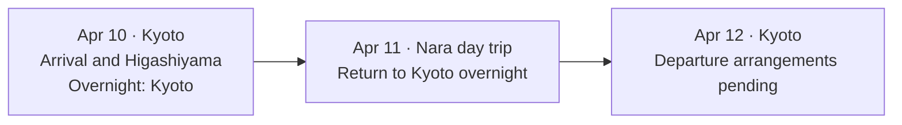

# Japan Travel Skills

**Japan Travel Skills** is an open-source set of Agent Skills for planning and reviewing trips to Japan. Use it to plan a trip, check the feasibility of an existing itinerary, or turn a plan into an interactive HTML travel map and a PowerPoint handoff. The project includes thirteen skills, with independent tools for dated train and bus routes, weather, hotels, restaurants and seasonal travel research. Results retain original source links and what still needs checking.

The project supports discovery, introductions, prices, availability, conditions and original booking links. Users complete reservations and purchases manually or with another agent. Transactions, holds, waitlists and payments are outside the project scope. Source uncertainty is preserved in planning results.

## Start with a Japan travel planning task

| I want to… | Start here |
| --- | --- |
| Plan a Japan trip with trains, hotels and local food | [Build a sourced itinerary](skills/japan-travel-planner/examples/hokuriku-six-days.md) from a dated worked example. |
| Check an existing Japan itinerary for closures, last entry and tight connections | [Check a Japan travel itinerary](docs/check-japan-itinerary.md), with an example request and the evidence to retain. |
| Create a Japan itinerary map or PowerPoint for my travel companions | [Turn an itinerary into a map and PowerPoint](docs/japan-itinerary-map-and-powerpoint.md), with an offline HTML demo and a shared presentation brief. |
| Use one tool, such as Japanese rail timetables or hotel discovery | Choose the relevant specialist below. |

See [installation](docs/installation.md) to use individual skills in a compatible host or install the full Codex plugin.

## Available capabilities

| Skill | Capability and source scope |
| --- | --- |
| [Travel planning and visual guides](skills/japan-travel-planner/SKILL.md) | Build, review or revise itineraries; create requested interactive HTML/map guides and coordinate PPTX handoffs using host authoring tools |
| [City guides](skills/japan-city-guide/SKILL.md) | Official attraction, event, food and route sources for Tokyo, Osaka, Kyoto, Sapporo, Fukuoka, Nagoya, Yokohama, Kobe, Nara and Naha, plus Kanazawa, Takaoka, Toyama City and Nagano City; prefectural discovery and facility verification; no dedicated CLI |
| [Tabelog](skills/tabelog/SKILL.md) | Restaurant search, details/courses, reviews, awards and anonymous date/party/time availability |
| [TableCheck](skills/tablecheck/SKILL.md) | Restaurant discovery, courses and anonymous date/time availability; course/seat checks on supported public v1 forms |
| [Pocket Concierge](skills/pocket-concierge/SKILL.md) | Native restaurant discovery, courses, calendar hints and course-linked sessions; instant/request/waitlist modes remain separate |
| [Weather](skills/japan-weather/SKILL.md) | Weathernews forecasts for about two weeks; optional JMA forecasts for about one week; current JMA meteorological-warning/advisory snapshots and monthly station climate normals |
| [Transit](skills/japan-transit/SKILL.md) | Yahoo! 路線情報 rail/bus stop lookup, dated routes, transfers, fares and first/last connections; separate official line reports for nine JR West Hokuriku sections and IRいしかわ鉄道 |
| [Holidays](skills/japan-holidays/SKILL.md) | Cabinet Office live public holidays by date/range/year, weekdays, weekends and consecutive calendar breaks |
| [Daylight](skills/japan-daylight/SKILL.md) | NAOJ's live named-location calculator for sunrise, sunset and daylight length by date/range |
| [Seasons](skills/japan-seasons/SKILL.md) | Separately attributed Weathernews spot records and JMC city/species tables for sakura and foliage; predictions, observations and season availability stay distinct |
| [Mount Fuji](skills/japan-fuji/SKILL.md) | AMECS seven-day north/south foothill viewing indices by AM/PM; broad directional reference, with initialization freshness retained |
| [Hotels](skills/japan-hotels/SKILL.md) | Undated Jalan landmark discovery, bath/station filters, coordinate-based straight-line radius, static profiles and room-type tables |
| [Rail passes](skills/japan-passes/SKILL.md) | Live official catalogs, prices, eligibility and conditions for nationwide JAPAN RAIL PASS, JR West/joint passes, Tourist Pass, Hokkaido and Shikoku; JR East/Kyushu are reference-only |

Each linked skill documents its workflow, supported locations, source policy and result interpretation. Nationwide scope depends on each source's coverage. City-guide references currently curate fourteen destinations, including ten popular-city starting points as a practical selection, not an official ranking. Municipal sources handle local discovery, and prefectural sources add explicitly wider scope; Tokyo's entry distinguishes its urban areas from the wider metropolis. The references guide live reading rather than storing attraction hours, prices or event calendars. Hotel discovery prioritizes suitable properties and practical details; dates are optional. Stay-specific inventory and cross-platform price comparison are secondary extensions.

Weathernews sakura forecast output still awaits in-season live validation; the seasonal skill retains this qualification separately from JMC and foliage coverage.

## Turn a plan into a travel guide

Visual delivery is a core capability, loaded only when requested. Ordinary planning or plan review
does not load templates or require a visual output. Ask, for example:

> Turn this itinerary into a mobile-friendly local HTML guide with a map. Include the city order,
> overnight bases, daily attractions, food and intercity connections. Keep candidates and unresolved
> checks visible. Also create a PPTX for discussing the plan with my travel companions. Do not publish it.

| Output | How it helps |
| --- | --- |
| Interactive guide | Switch days to see the matching schedule and transport; filter hotels, attractions, restaurants and stations; inspect source links and coordinate provenance. |
| Presentation/PPTX | An illustrated guide to cities, lodging, sights and food, with dates, connections and decisions. Includes photo-page patterns and source/credit guidance; actual slide creation uses the host's authoring tools. |
| Shared plan records | Keep dates, choices, conditions and sources consistent across outputs and subsequent revisions. |

The [delivery guide](skills/japan-travel-planner/references/deliverables.md) links a reusable,
dependency-free local HTML template and a presentation handoff brief. The page works without a
server or external requests by default; users can explicitly load official GSI basemap tiles.
Unknown coordinates stay in the list. Neither plotted locations nor schematic connections are
walking routes or live navigation. Hosting is separate and requires the user's request covering it.

Try the public [Kyoto–Nara demo records](skills/japan-travel-planner/examples/kyoto-nara-demo.json)
using the [generation instructions](skills/japan-travel-planner/references/plan-data.md).
It shows a Kyoto overnight base and Nara day trip, two named hotel candidates, local-food and
restaurant candidates, scoped source checks and unresolved decisions. Static introductions were
researched for this dated example; its future dates, activity times and transport remain planning
estimates, without stay inventory or a verified timetable. Recheck sources for a real trip.
Generate a guide and a presentation brief from the same records; the brief is not a PPTX file.
This curated example demonstrates the data format and rendering, not an independently generated
plan or a measured improvement in agent planning quality.



This schematic matches the illustrative demo snapshot; it is not a physical rail route or a
verified timetable. The generated page adds day selection, transport records and place filters.

## Use from this checkout

Clone the source repository:

```bash
git clone https://github.com/ScienJus/japan-travel-skills.git
cd japan-travel-skills
```

Travel CLIs require **Python 3.9+** and use the standard library. The nationwide JAPAN RAIL PASS (`jr-group`) source additionally requires system **curl**. Restaurant tools require **Python 3.10+** (3.12+ recommended) and the dependencies in their own `scripts/requirements.txt`. The city-guide skill needs an available web search/fetch tool and has no Python dependency or CLI. Planning needs only the relevant specialists or source-reading tools; the optional local visual helper uses Python 3.9+ without packages. None requires an API key, account, GUI browser or background service.

For all eleven tools, use a suitable Python environment and install the combined pinned dependencies. No wheel or editable project installation is needed:

```bash
python3.12 -m venv .venv
.venv/bin/python -m pip install -r requirements.lock
bin/tabelog doctor
bin/tablecheck doctor
bin/pocket-concierge doctor
```

Travel commands can still run with standard-library Python without installing restaurant dependencies. Restaurant wrappers select their named `*_PYTHON` override, then checkout `.venv/bin/python`, then `python3`; installed skills use an explicit environment interpreter and absolute script path.

Start by reading [AGENTS.md](AGENTS.md) and the relevant skill. `doctor` is offline for every CLI:

```bash
bin/japan-weather doctor
bin/japan-weather forecast --city 金泽 --days 14
bin/japan-transit --help
bin/japan-hotels --help
bin/japan-passes list --provider all
```

The `bin/` commands assume the checkout root. For a standalone or installed CLI-backed skill, use `python3 /absolute/path/to/skill/scripts/<entrypoint>.py ...` as documented in its `SKILL.md`. Copy the complete skill folder, including its LICENSE and runtime data. For city guidance, read `SKILL.md` and only the relevant regional reference; there is no `bin/japan-city-guide` or `doctor` command.

For travel questions spanning specialist capabilities, invoke `japan-travel-planner`; when one specialist can answer the request, use it directly. The planner loads only the needed specialists and their relevant references. It has no mandatory all-tools workflow and does not rely on this checkout's `AGENTS.md` being loaded after installation. Ordinary answers focus on travel results, sources and material limits; execution details are included for tool-use, reproducibility, efficiency or technical-failure questions.

Two starting points for the planner:

- **Build a plan:** "Use $japan-travel-planner to plan six days around Kanazawa, Takaoka, Toyama and
  Nagano in late November. I enjoy gardens and local food, prefer a relaxed pace and will use public
  transport. Start with the city order, overnight bases and daily areas so we can refine the details."
- **Review a plan:** "Use $japan-travel-planner to check the itinerary below for my specified dates.
  My hotels and departure flight are fixed. Check opening conditions, transport connections and
  realistic time allowances; distinguish confirmed conflicts, suggested adjustments and unknowns.
  Preserve my choices and suggest the smallest changes needed. [Paste the itinerary here.]"

For local changes, such as replacing an outdoor afternoon, ask the planner to revise that portion
and check affected connections. A review states its verification scope; it does not certify every
condition of the trip.

The planner's [planning loop](skills/japan-travel-planner/references/planning-loop.md) and
[worked six-day example](skills/japan-travel-planner/examples/hokuriku-six-days.md) show how a brief
becomes a city/base outline, how admission/closure conflicts change the schedule, and what remains
for the user to decide. The example is a dated teaching snapshot, not live travel advice or evidence
of a measured improvement across models.

Commands emit JSON with source metadata and measured request usage. Inspect status, coverage and unknown fields even when the process exits successfully. Use the relevant skill's native lookup and source checks before interpreting results. Detailed examples and provider-specific qualifications live with each skill.

## Install the bundle or one skill

Follow [installation and runtime compatibility](docs/installation.md) for complete-plugin or single-skill installation, Python dependencies, updates and validation boundaries. That guide is the maintained source for host-specific install commands.

The [plugin manifest](plugin.json) and [local marketplace entry](.agents/plugins/marketplace.json) expose one `japan-travel` plugin containing all thirteen skills. It needs a local executor. Installing the plugin does not install Python dependencies; client support varies. Individual specialist folders can also be installed independently in a compatible skill host.

This project is a local distribution and has not been published to a public marketplace. Building a ZIP does not install or publish it.

For publication, follow the [release preparation guide](docs/releasing.md). It covers source checks,
bundle inspection, checksums and the separate repository/release and plugin-directory steps.

## Build a shareable bundle

From the development checkout:

```bash
python3 scripts/build_plugin.py
# Optional explicit output, outside the checkout:
python3 scripts/build_plugin.py --output /absolute/path/outside-the-checkout/japan-travel.zip
```

Default output is `~/.local/share/japan-travel-skills/artifacts/japan-travel-<version>.zip`; the version comes from `plugin.json`. ZIPs and extracted installation/test copies stay outside the checkout. The builder rejects output inside its source directory.

The ZIP contains the manifests, root documentation/license, CLI wrappers and complete skills. Its exact file lists are maintained in `scripts/build_plugin.py`; local files are excluded regardless of Git availability or ignore rules. Adding a distributed resource requires updating that list. Building does not install or publish anything. The CI workflow retains a downloadable bundle and checksum after the Ubuntu/Python 3.12 checks pass; inspect all matrix results before release.

## Contributing

Found a problem or a useful official source? Contributions are welcome, including issue reports,
fixes, new travel-research tools and more city guides. See the [contribution guide](CONTRIBUTING.md)
for reporting details, source-quality expectations and how to add a destination. You do not need
to write code to help.

## Development

Use a source checkout for these commands. The shareable ZIP omits tests, developer scripts and developer dependencies.

```bash
.venv/bin/python -m pip install -r requirements.lock -r requirements-dev.txt
.venv/bin/python scripts/check_repo.py
.venv/bin/python scripts/check_privacy.py
.venv/bin/python -m unittest discover -s tests -v
```

For fresh-agent behavior checks, use `scripts/prepare_behavior_check.py` and the procedure in `tests/behavior/README.md` from a source checkout. Reusable tasks cover routing, source interpretation and stopping rules. Run records and scores stay outside the repository; these optional checks are separate from offline CI.

Tests are offline, including distribution relocation and independent-skill checks. `requirements-dev.txt` adds only the YAML parser for developer metadata/link checks and behavior-test preparation; installed skills do not depend on it. GitHub Actions runs the full suite on Python 3.10/3.12 on Ubuntu and 3.12 on macOS, with a separate dependency-free Python 3.9 travel-tools job. CI does not query providers or publish artifacts. Source refresh and request policies are documented in the relevant skills; for weather metadata maintenance, see [JMA](skills/japan-weather/references/jma.md) and [Weathernews](skills/japan-weather/references/weathernews.md). Store captures, investigations and acceptance records outside the repository, even when ignored. Keep version metadata stable during unpublished development.

From a source checkout, `tests/browser/README.md` describes optional headless checks for filters,
date/transport synchronization, JSON export, offline fallback and phone layouts. Node and
Playwright are development-only; they are not needed to generate or open the guide.

The restaurant skills are copied from [Japan Restaurant Skills](https://github.com/ScienJus/japan-restaurant-skills), with their licenses and upstream attribution retained. They run independently here; the original repository is not a runtime dependency. HTTP clients follow the [development contract](docs/http-client.md) and one offline behavior matrix, while keeping implementations and source policies local to each skill. No cross-skill HTTP runtime library or generated copies are required. Restaurant commands retain their native exit codes: 0 for ok, 3 for partial, 1 for error; read each travel skill for its own status/exit-code rules.

## Sources and license

See the [source classification and selection policy](docs/sources.md) for public institutions,
operators, commercial platforms and community helpers. Tabelog geocoding defaults to GSI; Photon/
OpenStreetMap requires explicit selection. Its local `jpholiday` calculation is separate from the
holiday CLI's official online feed. See [security and privacy](SECURITY.md) before sharing query
logs, reporting a vulnerability or publishing a bundle.

[MIT](LICENSE) covers project code. Third-party information retains its own terms and attribution requirements; public readability does not grant redistribution rights or establish provider endorsement. Each skill links its original sources and usage conditions. Query on demand, respect source capacity and access restrictions, and preserve unknown states when data is absent, stale or unsupported.
